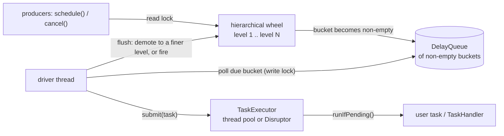

# Design

How the pieces fit, and why they are the way they are. Numbers quoted here come from
[`benchmarks/RESULTS.md`](../benchmarks/RESULTS.md).

## 1. Architecture

Three layers sit on top of each other:

| Layer | Classes | Responsibility |
|---|---|---|
| Timer | `TimingWheelTimer`, `TimingWheel`, `TimerTaskList`, `TimerTaskEntry`, `TimerTask`, `Clock` | schedule, cancel, fire; in memory |
| Execution | `TaskExecutor`, `ThreadPoolTaskExecutor`, `DisruptorTaskExecutor` | where due tasks run |
| Durability | `DurableScheduler`, `TaskStore`, `InMemoryTaskStore`, `RocksDbTaskStore`, `TaskRecord`, `TaskHandler`, `RetryPolicy`, `NonRetryableException` | survive crashes, acknowledge, retry, dead-letter |

The durable layer is optional: `TimingWheelTimer` works on its own.

## 2. The hierarchical wheel

### Data structures

- **`TimerTask` is the public handle, `TimerTaskEntry` is the list node.** The task owns the state
  machine and the user's action; the entry owns the links, the bucket it is in and its deadline.
  Splitting them keeps internal locks and pointers out of the object users hold, and lets the same
  task be placed again in a different bucket (demotion, retry).
- **A bucket is a circular doubly linked list with a sentinel node**, so insert and remove are O(1)
  with no null checks. `TimerTaskEntry.remove()` loops until the entry belongs to no list, because
  a concurrent flush can move it to another bucket between reading its list and removing it.
- **One `DelayQueue` holds the non-empty buckets of every level**, not the tasks. A bucket is
  offered only when its expiration changes (it went from empty to non-empty), so the queue stays as
  small as the number of occupied buckets and the driver thread sleeps until the earliest one
  instead of waking every tick.

### Levels and rounding

With level-1 tick `t` and `n` buckets per level:

| Level | Bucket width | Covers | Rounding of a deadline | Fires tasks? |
|---|---|---|---|---|
| 1 | `t` | `(n−1)·t` ahead | **up** to the next tick boundary | yes |
| 2 | `(n−1)·t` | `n·(n−1)·t` | **down** to the bucket start | no, it demotes |
| 3 | `n·(n−1)·t` | `n²·(n−1)·t` | down | no, it demotes |
| k ≥ 4 | previous level's whole span | | down | no, it demotes |

For `t = 1 ms`, `n = 512`: level 1 covers 0.5 s, level 2 about 4.4 minutes, level 3 about 37 hours,
level 4 about 2 years. Levels are created on demand.

- **Level 1 rounds up, so a task is never early and at most one tick late.** Coarse levels round
  down, so their bucket starts at or before the deadline and the task can be demoted in time; the
  finer level then positions it exactly. A task never fires from a coarse bucket.
- **Level 1 spans `(n−1)·t`, not `n·t`.** The slot of the current tick is left free: it may hold a
  bucket that is due but not yet flushed, and reusing it would change the expiration of a bucket
  already inside the `DelayQueue`, corrupting its order.
- **Level 2's width is exactly what level 1 can hold, `(n−1)·t`.** This is what makes demotion
  terminate: a task demoted from level 2 always fits level 1. With the more obvious width `n·t`,
  a task in the one-tick gap would not fit level 1, return to the same level-2 bucket, be due
  immediately and loop forever. The invariant is that every coarse bucket starts strictly after
  the level-1 time, so it can never be due at the moment it is created. A test replays a task
  down through levels 3, 2 and 1 and asserts the bucket it sits in at every step.
- **Time only moves after every due bucket has been flushed.** Otherwise a stale bucket could be
  reused for a deadline one revolution later. After flushing, the wheel is advanced to "now", which
  also fixes the "idle for a minute, then schedule 10 s" case where the wheel's time had lagged.

### Clock

`Clock.SYSTEM` is `System.nanoTime() / 1_000_000` (monotonic, millisecond resolution). Because
it floors, a task can run up to just under 1 ms before its exact-nanosecond deadline, never more;
the load test counts anything over 1 ms as an error and found none.

## 3. The timer facade

- `schedule` takes the **read lock** (many producers in parallel); moving time and flushing takes
  the **write lock**.
- The driver loop waits on the `DelayQueue` **outside** the lock, then flushes every due bucket.
- Tasks are handed to a `TaskExecutor`; with a direct executor they run on the driver thread, which
  is what the "inline" benchmark candidates do.
- If the executor refuses a task, the timer calls an optional **rejection handler** instead of
  losing the task; `DurableScheduler` uses it to re-offer the task.

## 4. Task semantics

`TimerTask` is a small state machine, `PENDING → CANCELLED | FIRED`, moved by compare-and-set:

- a task **runs at most once**;
- after a successful `cancel()` it **never runs**, even if it was already handed to an executor
  (the worker calls `runIfPending()`, which only runs a task it can move from `PENDING` to `FIRED`);
- an exception from the action is logged and never escapes into a worker thread.

`runIfPending()` is shared by every executor, so a new executor cannot implement these rules wrongly.

## 5. Execution layer

`TaskExecutor.submit(task)` **never blocks** (it runs on the driver thread, and a blocked driver
stops the whole wheel) and returns `false` when it cannot accept the task. `close()` is graceful and
idempotent. Both implementations use a **bounded** buffer so that a full executor is visible
rather than silent, which also makes the two comparable.

- `ThreadPoolTaskExecutor`: a bounded `ArrayBlockingQueue` with an abort policy; it can also wrap an
  existing `Executor` without owning it.
- `DisruptorTaskExecutor`: a pre-allocated ring buffer, multiple producers (already-due tasks are
  submitted from the caller's thread), a worker pool where each slot is consumed by exactly one
  worker, and `tryPublishEvent` for the non-blocking hand-off.

`TaskExecutorContractTest` is an abstract test class that both implementations extend, so they are
held to identical behaviour.

## 6. Durable layer

### What is stored

A `Runnable` cannot be persisted, so a durable task is **data**: `TaskRecord` = id, an **absolute
wall-clock deadline** (epoch ms), an opaque payload, the number of failed attempts and the last
error. The wheel's clock is monotonic and meaningless after a restart, so recovery re-arms each
task with `deadline − now` computed on the wall clock. Records are written in format version 2;
version 1 still loads.

### Ordering is the design

| Operation | Order | A crash in the middle leaves |
|---|---|---|
| schedule | store the record, **then** arm the wheel | a stored task; recovery arms it |
| acknowledge | run the handler, **then** remove the record | the record; the task runs again (at-least-once) |
| retry | persist `attempts + 1`, last error and the **next deadline**, **then** re-arm | the persisted retry state; attempts are not reset |
| dead-letter | move the record from the active set to the dead-letter set in **one atomic step** | the task in exactly one of the two sets |
| cancel | remove the record, **then** cancel the wheel entry | no record, so nothing resurrects it |
| recover | reload every active record, re-arm with the remaining time, overdue ones run immediately in deadline order | |

### Delivery semantics

- **At-least-once.** Handlers must be idempotent. `TaskRecord.attempts()` tells a handler whether it
  is running a retry.
- Returning normally acknowledges; throwing is a failed attempt, retried per `RetryPolicy`
  (exponential backoff, a cap, jitter); `NonRetryableException` skips the remaining attempts.
  Attempts are persisted, so a poison task cannot retry forever by crashing the process.
- **A refusal by a full executor is not a failed attempt.** The handler never ran, so no attempt is
  used; the task is re-offered shortly after.
- **`cancel` is strict.** Before starting a task the scheduler re-checks that its record still
  exists, so once `cancel(id)` returned `true` the handler will not be started, including for a
  task waiting for a retry or for the executor.
- **Dead letters** can be listed, retried by a human (attempts reset) or discarded.

### Stores

`TaskStore` has two key spaces, active and dead letters, and one contract test class that every
implementation extends; durable ones also close and reopen the store and check nothing was lost.
`RocksDbTaskStore` keeps `a:<id>` and `d:<id>` keys, moves a record between them with one
`WriteBatch`, and fsyncs every write by default (`syncWrites=false` trades the last few writes on a
power cut for throughput). RocksDB locks its directory, so one process owns a store.

## 7. Testing

| Kind | What it covers |
|---|---|
| Unit | bucket list, wheel placement and rounding, record encoding, retry arithmetic |
| Deterministic timer tests | a manual clock and a direct executor: exact fire times across 5 levels, never early, less than one tick late, a single jump of the clock |
| Demotion trace | the bucket a task sits in after every step of its way down |
| Randomised | 20 000 timers across four levels, exactly once, never early |
| Contract tests | one abstract class per interface (`TaskExecutor`, `TaskStore`), extended by each implementation |
| Concurrency | real clock, multiple producers, cancellations racing firing |
| Crash recovery | a new scheduler on the same store, with a different monotonic clock and downtime in between |
| CI | GitHub Actions: Linux and Windows, JDK 17 and 21 |

During development the critical invariants were also **mutation-checked by hand**: each was broken on
purpose (for example "remove the record before running the handler", "round coarse levels up",
"do not persist retry state") to confirm that a test fails. That is a manual practice, not an
automated mutation-testing run.

## 8. Decisions and their alternatives

| Decision | Alternative | Why |
|---|---|---|
| Bucket-driven `DelayQueue` | tick every millisecond | no wake-ups for empty ticks; queue size bounded by occupied buckets |
| Round up at level 1 | round down to the bucket start (as Kafka's `SystemTimer` does, so with a tick above 1 ms a task can fire up to one tick early) | a timeout must not fire early |
| Level 2 width `(n−1)·t` | `n·t` | demotion terminates |
| Read/write lock | one lock | producers do not block each other |
| `TaskExecutor` with a non-blocking `submit` | pass an `Executor` | a full queue must be visible and must never block the driver |
| Store before arming | arm, then store | a crash can never lose a task the caller was told about |
| Wall-clock deadlines in the store | monotonic | monotonic time is meaningless after a restart |
| Refusals do not count as attempts | count them | after an outage many tasks are refused, and good tasks would be dead-lettered |
| Bench: differences, not baselines | absolute used-heap | the reading after a GC carries a collector-dependent offset |
