# 时间轮任务调度器phase1技术总结

重点是数据结构和调用关系

## 图 1：TimerTask 状态机

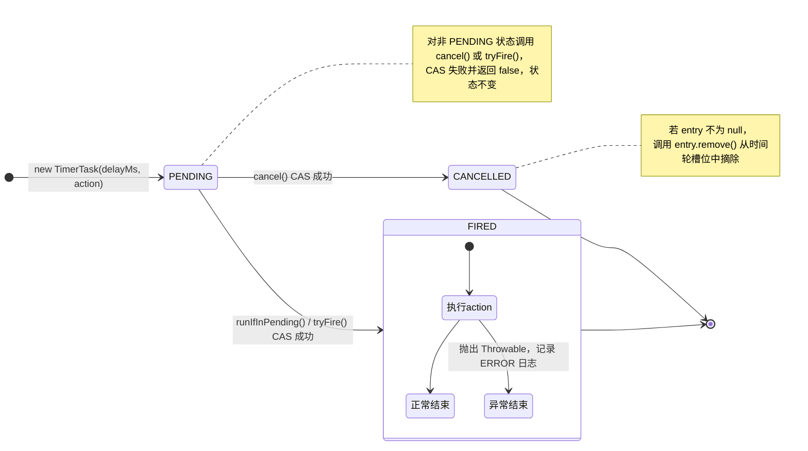
1. Task是最终业务的逻辑单位，比如在订单履行中30分钟定时任务检查用户是否付款，如果用户不付款，取消订单
2. Task的初始状态是pending， 通过CAS修改状态，取消后变为Cancelled， 执行后变为Fired， 不管执行的结果如何task会变为fired
3. Entry是双链表的节点，用于放task，task 和 entry是一一对应的关系，相互引用，task执行或者取消，entry包含task会从双链表中删除

## 图 2：TimerTaskEntry 类图（与 TimerTask、TimerTaskList 的关系）

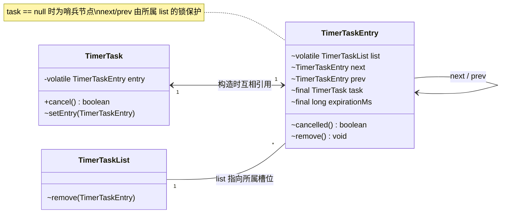
1. task 和entry是一一对应的，entry的作用就是维护了双链表的结构，entry是TimerTaskList 的一个节点，TimerTaskList是时间轮中的一个桶，也就是说一个桶是一个list，entry是list中的一个节点

## 图 3：TimerTaskList 槽位结构（环形双向链表与 DelayQueue）

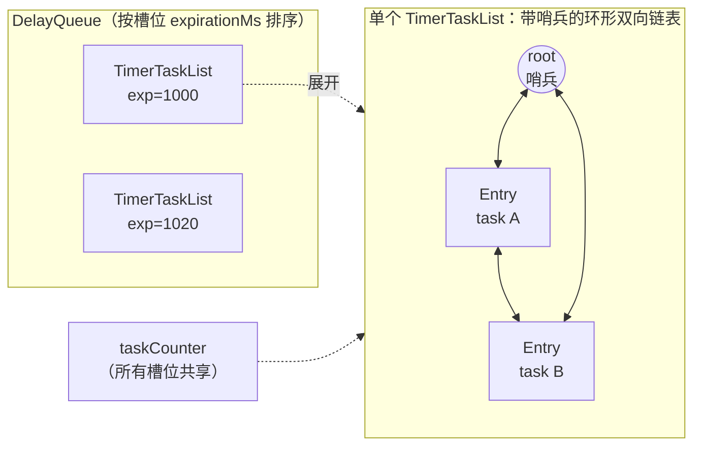
1.每个TimerTaskList是一个槽位，每个槽位只有一个任务到期时间，所有的任务通过双向链表连接起来，所有任务都是一个到期时间
2.DelayQueue只保存有任务的桶（TaskTimerList），而且是按照到期时间顺序排列，快要到期排在前面，所以理论上我们可以通过两个路径找到一个任务，一个是delayqueue，一个是通过wheel，只是delayqueue是O（1）的

## 图 4：TimingWheel 层级数据结构

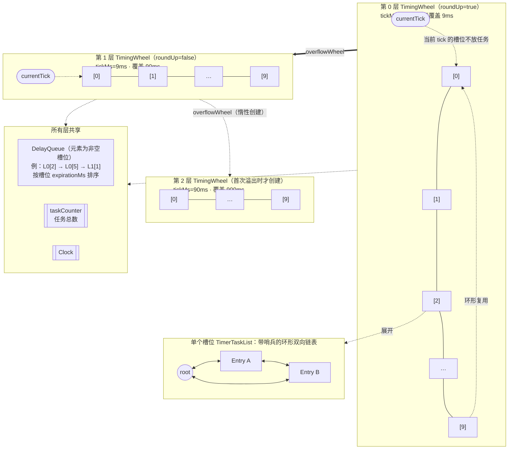
1.时间轮结构，类似于一个钟表，currentTick就是指针，表上的刻度就是槽位，一旦指针走到了哪个槽位，这个槽位的所有任务就到了执行时间， 因为每个刻度代表的时间有限，也意味着每个表代表的时间也是有限的，比如每个刻度代表1ms，一圈10个刻度也就能代表10ms，我如果要把11ms需要执行的任务怎么放进去呢？ 这里就到了overflow的概念了，如果本层轮放不下去，那就overflow到下一层的轮，下一层的每个刻度代表下层一整个表盘的时间长度，以刚才的例子为例，也就是说下一层一个刻度就是10ms，假设还是10个刻度，一共就是100ms， 如果时间再长，那就继续overflow到再下一层，直到整个表盘代表的时间溢出（long型）， 按照每个刻度1ms，每层表盘10个刻度，可以支撑2亿年之后的时间，实际上是足够了。
2.时间轮的0级时默认创建的，后面的overflow层都是有需要才创建的，时间轮本质上时一个数组，数组的元素时TimerTaskList，我们称之为桶，时间轮的大小再初始化时由输入确定
3. 不管task处于时间轮的那一层，这个task所在的桶的引用都保存在delayqueue， 按照过期时间有序排列

## 图 5：TimingWheel.add() 流程

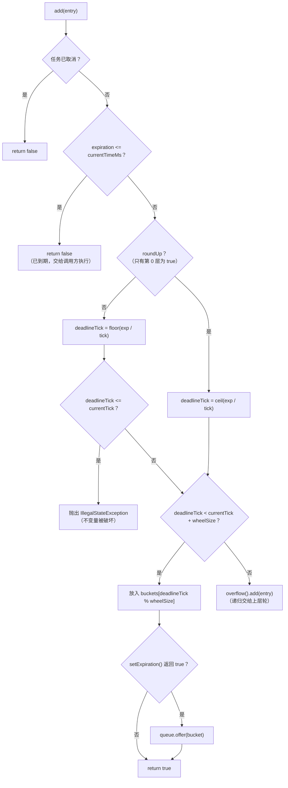
1， 正常流程中任务被加入到时间轮的桶中后，如果桶已经在delayqueue了，就什么也不用做了，如果这个task是这个桶的第一个任务，那么加完时间轮后还要把任务所在的桶加到delayqueue中

## 图 6：任务添加和触发过程（DelayQueue 与多层时间轮，示例 expiration=105ms）

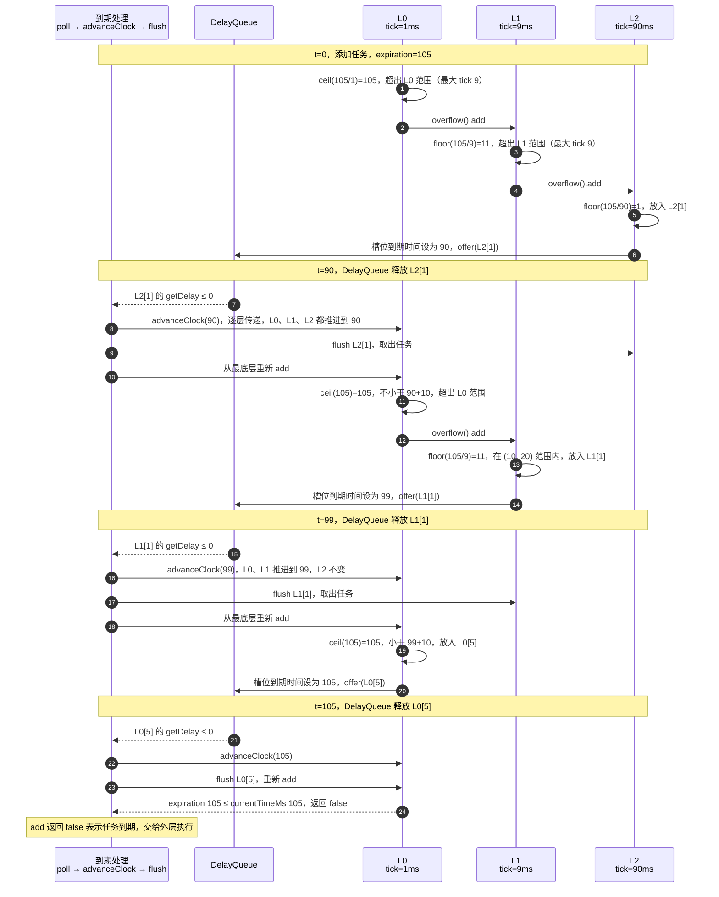
1. 整个过程中多次出轮出queue， 因为涉及时间轮overflow和降级

## 图 7：TimingWheelTimer 结构

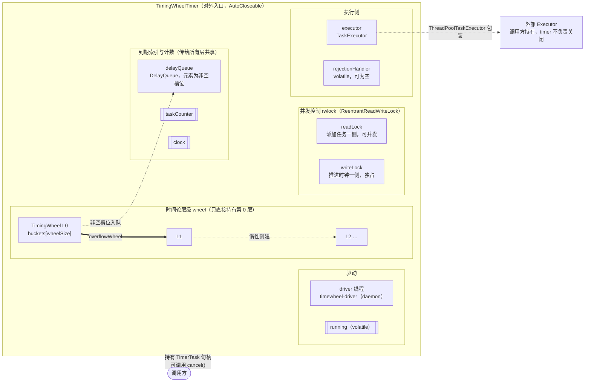
1. TimingWheelTimer 是对外的入口，提供任务的schedule 和cancel等接口，同时持有驱动进程， 调用方可以把Executor作为参数传递进去
2. 并发控制：写锁独占执行任务出轮，此时禁止任务添加；写锁释放后，一般是阻塞在delayqueue上, 此时多个线程可以同时添加任务到时间轮，但是添加任务到一个桶或桶的一个节点需要串行化，
这里由桶的synchronized和节点的synchronized来保证。

## 图 8：TimingWheelTimer 读写锁与锁分层

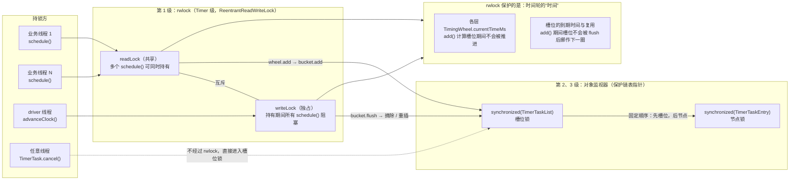
1.时间轮的槽位在是循环使用的，槽位的选择取决于两个因素currentTick 和 DeadlineTick，同样的到期时间，和目前时间在一个时间轮的时间跨度内，
就会在本层入轮， 否则就可能需要到其他层入轮； 在执行往桶中add()时，时间不可以推进， 否则就有可能把本轮需要触发的任务加到下一轮去，虽然是一个桶，
因为时间的推进，这个桶已经作为下一轮使用了。 这个机制的保证是add（）线程是持有读锁的，这时候算出的槽位是根据现在的时间和到期时间算出来的， 
这时候如果想推进时间需要获取写锁，需要等待读锁释放

## 图 9：并发控制，多个线程向同一槽位并发添加任务
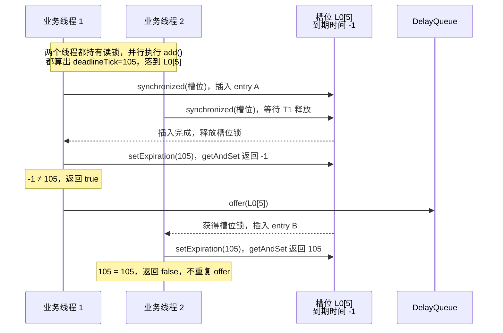
1.添加任务的前提是首先目前写锁是释放的， 然后多个线程可以同时向桶里添加任务，同一个桶和同一个任务是通过synchronized保证串行化的。

## 图 10：ThreadPoolTaskExecutor 结构（两种模式）
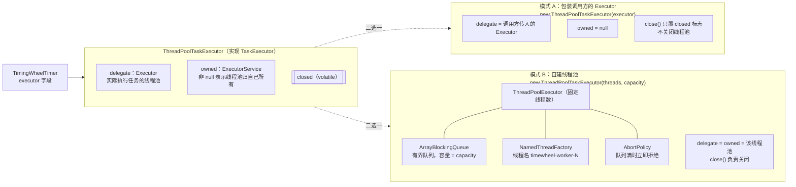
1.任务执行器可以选择自建ThreadPool也可以从外部传入

## 图 11：调用关系（TimerTask 到 TimingWheelTimer）

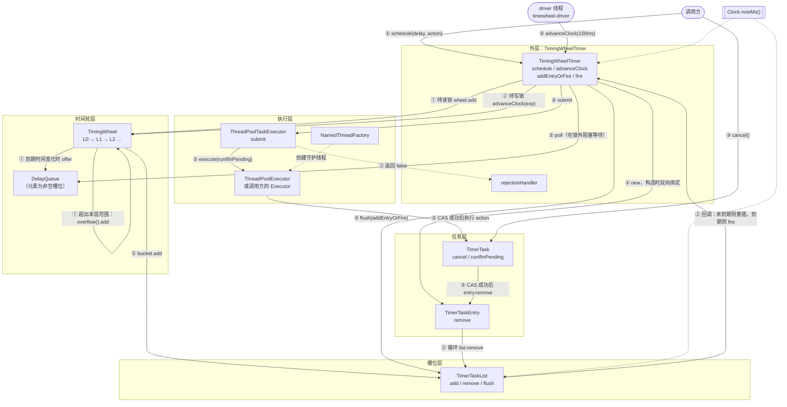
1. @1 添加任务 @2 时间推进与执行  @3 取消任务

## 图 12：DurableScheduler 的数据分布（以任务 order-123 为例）

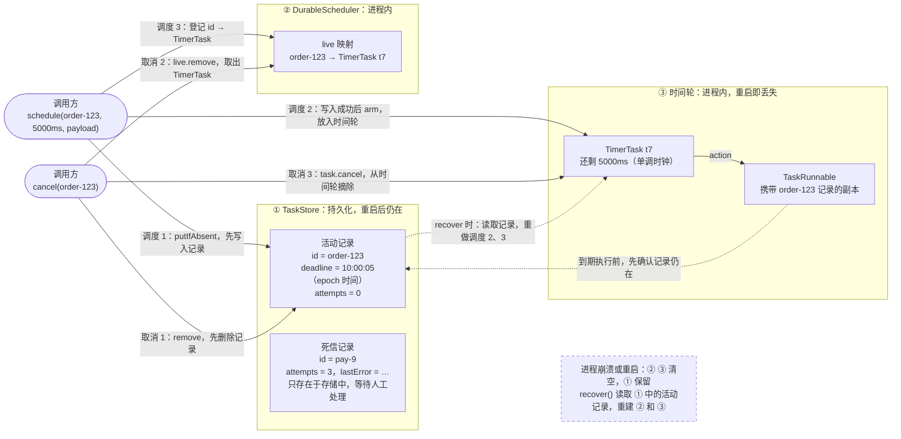
1. taskstore 是任务的持久化层，用于存储活动task 和死信记录
2. 恢复时先从taskstore 恢复， taskstore 可以有多种实现方式，可以是RocksDB,也可以是Redis
3. 
## 图 13：TaskStore 中记录的生命周期

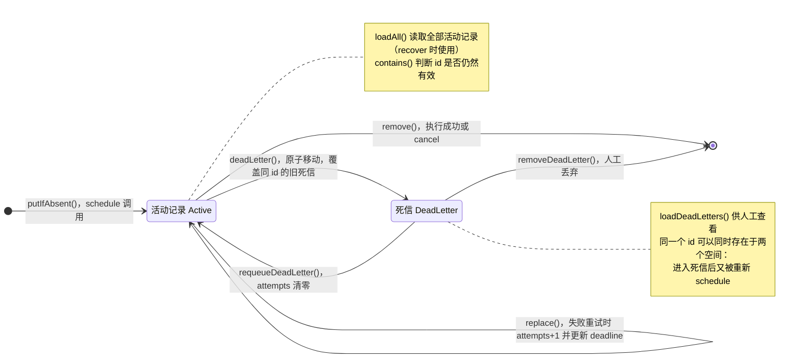
1. 任务入轮是被拒绝，继续尝试，入轮时间加抖动
2. 任务执行失败，更新到期时间，更新数据库记录，从新入轮， 如果失败多次达到配置的失败次数，进入死信队列，
3. 死信队列的内容需要运维接入，提供重新放入数据库和入轮的接口

## 图 14：整体调用关系（DurableScheduler 持久化层）

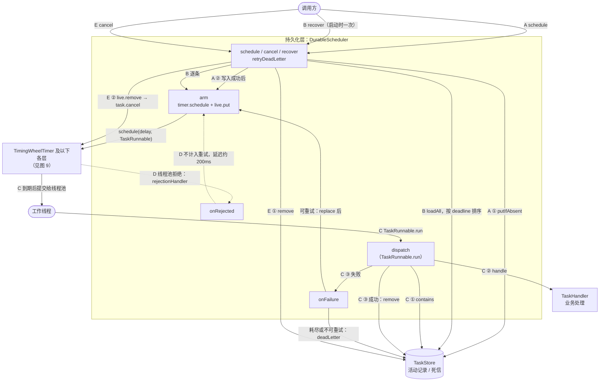

1.A 调度	先写存储，再放入时间轮	崩溃时任务留在存储里，恢复后重新放入时间轮
2.B 恢复	加载全部活动记录，已过期的立即执行	必须在调度之前调用
3.C 执行	检查记录 → 执行业务 → 根据结果删除、重试或转入死信	执行完才删记录，崩溃时任务会重复执行
4.D 拒绝	线程池拒绝，说明业务没有执行，稍后重投	不消耗重试次数
5.E 取消	先删存储，再取消时间轮里的任务	崩溃时被取消的任务不会复活

## 图 15：时间轮启动与任务唤醒机制（启动 → 等待 → 唤醒 → 执行 → 关闭）

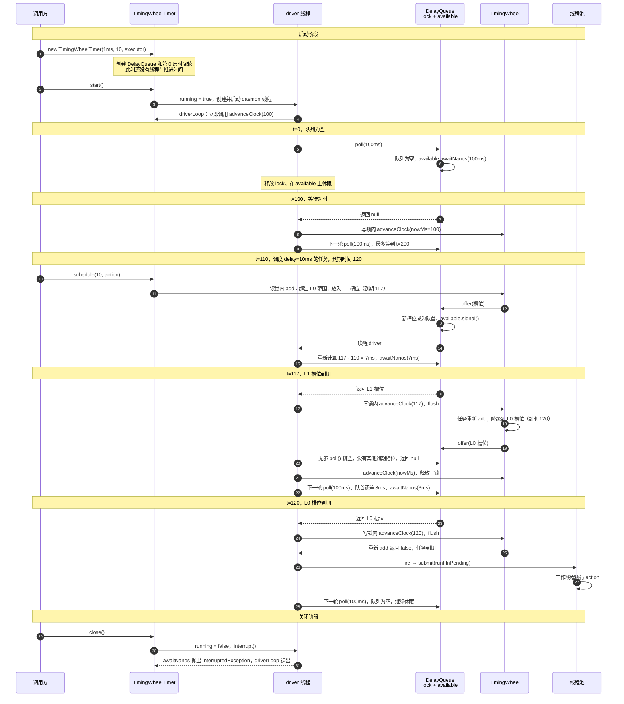
1.启动：构造函数只创建数据结构，不会推进时间。start() 之后 driver 线程立即进入 advanceClock()，并停在 poll(100ms) 里等待，中间没有任何前置延迟。
2.空闲等待：队列为空时，driver 在 available 上最多休眠 100ms，超时后把时间轮推进到当前时间，然后再次等待。
3.新任务唤醒：offer() 让新槽位成为队首时，通过 available.signal() 唤醒 driver，driver 按新队首的剩余时间（7ms）重新等待，而不是等到 t=200。
4.跨层降级：t=117 是第 1 层槽位到期，任务只是被降级到第 0 层，并没有执行；t=120 第 0 层槽位到期，重新 add 返回 false，才真正提交给线程池执行。
5.关闭：close() 先把 running 置为 false，再中断 driver。driver 正在 awaitNanos 中休眠时会立刻抛出 InterruptedException，driverLoop 捕获后直接返回，不需要等到 100ms 超时。
